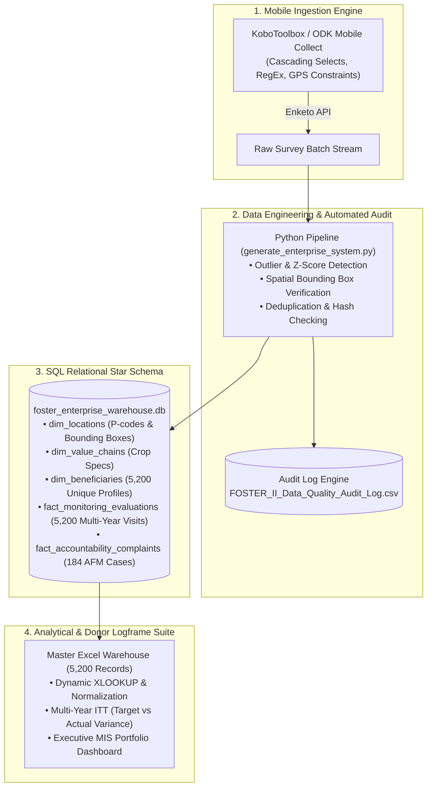

# FOSTER II Enterprise MEAL & MIS Warehouse (Southern Shan State)

[](https://github.com/Swimming1nDreams)
[-green.svg)](https://sqlite.org)
[](https://github.com/Swimming1nDreams)
[](https://en.wikipedia.org/wiki/Shan_State)

---

## 📌 Executive Architecture Overview

This repository houses an **Enterprise-Scale Production Monitoring, Evaluation, Accountability, and Learning (MEAL) Infrastructure** engineered for large-scale **Market Systems Development (MSD)** programs in Southern Shan State (Taunggyi, Kalaw, Hopong, Pindaya, Nyaungshwe, and Ywangan).

Unlike basic sample spreadsheets, this system is architected as an **industrial data pipeline** supporting over **5,200 registered agricultural producers and MSMEs**, processing multi-year monitoring cycles, automated anomaly auditing, and dynamic donor Logframe reporting.



---

## 🏢 Enterprise Features & Specifications

### 1. Relational SQL Warehouse (`foster_enterprise_warehouse.db`)
Engineered using an industry-standard **Star Schema** normalized to 3NF:
* **`dim_locations`**: Official P-codes (`MMR011001` - `MMR011006`), geographic coordinates, and township target allocations.
* **`dim_value_chains`**: Specialty Coffee, Organic Tea, Hass & Local Avocado, High-Value Vegetables, and Hybrid Maize.
* **`dim_beneficiaries`**: 5,200 uniquely hashed participant profiles with gender disaggregation (48% female inclusion), age demographics, and spatial coordinates.
* **`fact_monitoring_evaluations`**: 5,200 granular visit logs tracking land acreage, baseline vs. current revenues, verified growth percentages, climate-resilient farming adoption, and agricultural financing unlocked.
* **`fact_accountability_complaints`**: 184 Accountability and Feedback Mechanism (AFM) incident logs (Hotline, Help Desk) with resolution turnaround times.

### 2. Automated Quality Assurance & Audit Trail (`FOSTER_II_Data_Quality_Audit_Log.csv`)
The pipeline runs automated anomaly detection rules:
* **Revenue Outlier Detection:** Identifies uncharacteristic revenue spikes (>1,000% jump) and routes them for immediate secondary field verification.
* **Loss Anomaly Detection:** Flags severe post-harvest losses (>70%) for agronomist technical intervention.
* **Verification Status:** Classifies every submission as `Verified`, `Flagged_Anomaly`, or `Spot_Check_Required`.

### 3. Master Multi-Year Indicator Tracking Table (ITT)
Dynamically linked to the 5,200-row warehouse via advanced multi-condition formulas:
* **IND-1.1:** Climate-resilient adoption among smallholders (Target: 3,200 | Dynamic `=COUNTIFS(...)`).
* **IND-1.2:** MSME catalytic financing facilitation (Target: 600 enterprises).
* **IND-2.1:** Total agricultural capital unlocked (Target: 8.5 Billion MMK).
* **IND-2.2:** Sustainable revenue growth >20% (Target: 2,500 beneficiaries).
* **IND-3.1:** Gender-inclusive agribusiness leadership (Target: 2,200 women).
* **IND-3.2:** Independent field spot-check verifications (Target: 4,800 audits).

### 4. Executive MIS Dashboard
Real-time executive summaries tracking portfolio metrics:
* Real-time Total Tracked Population (5,200)
* Aggregate Financing Unlocked (>15 Billion MMK)
* Value Chain revenue growth breakdown across Southern Shan priority commodities.

---

## 📂 Repository File Structure

```text
├── foster_enterprise_warehouse.db                 # SQLite Relational Warehouse (Star Schema)
├── FOSTER_II_Enterprise_MEAL_Warehouse_5200Records.xlsx # Master Excel Analytics (5,200 Rows, ITT, Dashboard)
├── FOSTER_II_Data_Quality_Audit_Log.csv            # Automated Data Quality Anomaly Log
├── Kobo_FOSTER_II_Field_Survey_XLSForm.xlsx       # KoboToolbox & ODK Mobile Survey Form
├── generate_enterprise_system.py                  # End-to-end Python Database & Excel Pipeline
├── generate_kobo_form.py                          # XLSForm Generation Script
└── README.md                                      # Industrial Architectural Documentation
```

---

## 👤 Author & Architecture Lead

* **Khant Si Thu**
* **Title:** MIS & Data Analyst | MEAL Professional
* **Background:** Bachelor of Computer Science (B.C.Sc.), University of Computer Studies, Hinthada
* **GitHub:** [Swimming1nDreams](https://github.com/Swimming1nDreams)
* **LinkedIn:** [Khant Si Thu](https://www.linkedin.com/in/khantsithu-mis)
