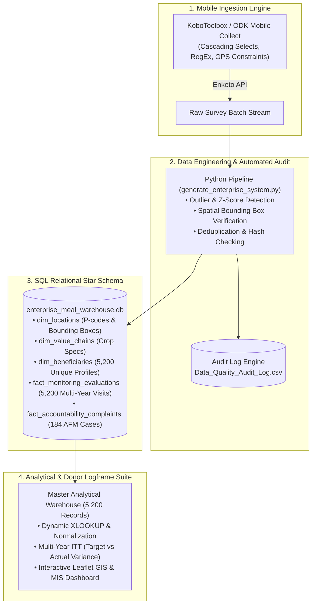

# Enterprise Agri-Market Systems (MSD) MEAL & MIS Cloud Platform

[](https://github.com/Swimming1nDreams)
[-green.svg)](https://sqlite.org)
[](https://github.com/Swimming1nDreams)
[-teal.svg)](https://en.wikipedia.org/wiki/Market_system)

---

## 📌 Executive Architecture Overview

This repository houses an **Enterprise-Scale Production Monitoring, Evaluation, Accountability, and Learning (MEAL) & Management Information System (MIS) Platform** engineered for large-scale **Market Systems Development (MSD)** and agricultural development programs.

Built to represent a production environment, the platform operates an **industrial data pipeline** supporting over **5,200 registered smallholder farmers and agri-food MSMEs** across multiple township clusters. The system integrates mobile data collection, real-time REST API services, relational data warehousing (Star Schema), automated data quality auditing, and interactive geospatial GIS analytics.



---

## 🏢 Enterprise Features & Specifications

### 1. Relational SQL Warehouse (`enterprise_meal_warehouse.db`)
Engineered using an industry-standard **Star Schema** normalized to 3NF:
* **`dim_locations`**: Official administrative P-codes, geographic coordinates, and regional target allocations.
* **`dim_value_chains`**: Specialty Coffee, Organic Tea, Hass & Local Avocado, High-Value Vegetables, and Hybrid Maize.
* **`dim_beneficiaries`**: 5,200 uniquely hashed participant profiles with gender disaggregation (48% female inclusion), age demographics, and spatial coordinates.
* **`fact_monitoring_evaluations`**: 5,200 granular visit logs tracking land acreage, baseline vs. current revenues, verified growth percentages, climate-resilient farming adoption, and agricultural financing unlocked.
* **`fact_accountability_complaints`**: 184 Accountability and Feedback Mechanism (AFM) incident logs (Hotline, Help Desk) with resolution turnaround times.

### 2. Automated Quality Assurance & Audit Trail (`Data_Quality_Audit_Log.csv`)
The pipeline runs automated anomaly detection rules:
* **Revenue Outlier Detection:** Identifies uncharacteristic revenue spikes (>1,000% jump) and routes them for immediate secondary field verification.
* **Loss Anomaly Detection:** Flags severe post-harvest losses (>70%) for technical agronomist intervention.
* **Verification Status:** Classifies every submission as `Verified`, `Flagged_Anomaly`, or `Spot_Check_Required`.

### 3. Master Multi-Year Indicator Tracking Table (ITT)
Dynamically linked to the 5,200-row warehouse via advanced multi-condition logic:
* **IND-1.1:** Climate-resilient adoption among smallholders (Target: 3,200 | Dynamic `=COUNTIFS(...)`).
* **IND-1.2:** MSME catalytic financing facilitation (Target: 600 enterprises).
* **IND-2.1:** Total agricultural capital unlocked (Target: 8.5 Billion MMK).
* **IND-2.2:** Sustainable revenue growth >20% (Target: 2,500 beneficiaries).
* **IND-3.1:** Gender-inclusive agribusiness leadership (Target: 2,200 women).
* **IND-3.2:** Independent field spot-check verifications (Target: 4,800 audits).

### 4. Interactive GIS Geospatial Dashboard (`http://localhost:8080`)
A high-performance modern web dashboard featuring:
* **Live Leaflet GIS Spatial Mapping:** Displays crop clusters and participant density across target townships.
* **Real-time Webhook Ingestion API:** Simulates field mobile survey ingestion with instant UI updates.
* **Filterable & Searchable Database:** Complete paginated access across all 5,200 records.

---

## 📂 Repository File Structure

```text
├── enterprise_meal_warehouse.db                   # SQLite Relational Warehouse (Star Schema)
├── Enterprise_MEAL_Warehouse_5200Records.xlsx     # Master Analytical Suite (5,200 Rows, ITT, Dashboard)
├── Data_Quality_Audit_Log.csv                     # Automated Data Quality Anomaly Log
├── Field_Survey_XLSForm.xlsx                      # KoboToolbox & ODK Mobile Survey Form
├── api_server.py                                  # Multi-threaded REST API Server
├── public/index.html                              # Interactive Leaflet GIS & MIS Dashboard
└── README.md                                      # Enterprise Architectural Documentation
```

---

## 👤 Author & System Architect

* **Khant Si Thu**
* **Title:** MIS & Data Analyst | MEAL Professional
* **Background:** Bachelor of Computer Science (B.C.Sc.), University of Computer Studies, Hinthada
* **GitHub:** [Swimming1nDreams](https://github.com/Swimming1nDreams)
* **LinkedIn:** [Khant Si Thu](https://www.linkedin.com/in/khantsithu-mis)
