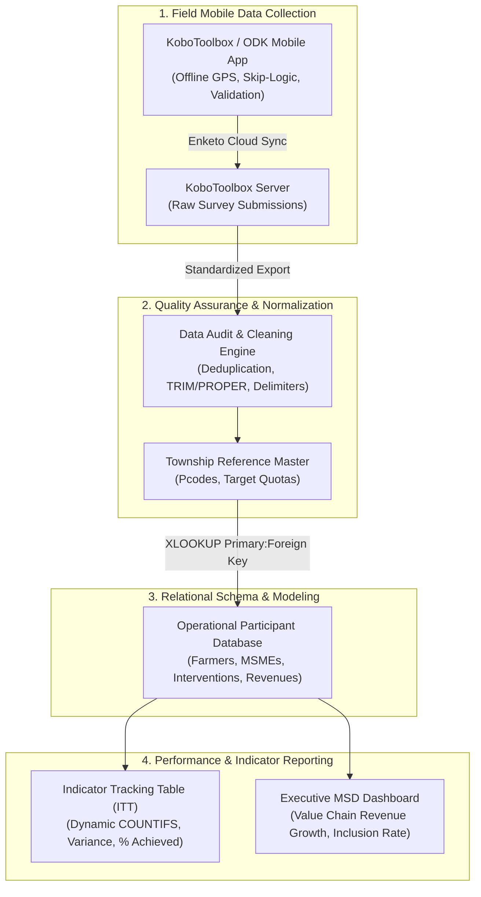

# FOSTER II Agrifood & MSME Market Systems MEAL Tracker (Southern Shan State)

[](https://github.com/Swimming1nDreams)
[](https://kf.kobotoolbox.org)
[](https://microsoft.com/excel)
[](https://en.wikipedia.org/wiki/Shan_State)

---

## 📌 Executive Summary

This project establishes an **end-to-end Monitoring, Evaluation, Accountability, and Learning (MEAL) tracking pipeline** engineered specifically for the **FOSTER II Project** implemented by **HEKS/EPER Myanmar Ltd.** in **Southern Shan State** (Taunggyi, Kalaw, Hopong, Pindaya, Nyaungshwe, and Ywangan).

Applying a **Market Systems Development (MSD)** approach, the system tracks systemic improvements across high-value agricultural value chains—including **Specialty Coffee, Organic Tea, Avocado, Maize, and High-Value Vegetables**. It captures data across smallholder farmers and agri-food Micro, Small, and Medium Enterprises (MSMEs), monitoring climate-resilient agricultural adoption, matching grants, private sector market linkages, and access to formal financial services.

---

## 🏗️ System Architecture & Data Flow



---

## 🎯 Key Project Components & Deliverables

### 1. KoboToolbox XLSForm Survey Specification (`Kobo_FOSTER_II_Field_Survey_XLSForm.xlsx`)
* **Standard 3-Sheet Structure:** `survey`, `choices`, and `settings` ready for direct import into KoboToolbox and ODK Collect.
* **Skip Logic & Dynamic Relevance:** Conditional survey paths (e.g. detailed climate practice inputs appear only if climate adoption is flagged `yes`; loan/grant amounts appear only if financial access is confirmed).
* **Field Constraints & RegEx Validation:** Automated validation prevents invalid data entry at point-of-collection (e.g., age constraints `18 <= age <= 90`, Myanmar mobile phone RegEx `^09[0-9]{7,9}$`, and non-negative revenue rules).
* **Bilingual Labels:** Full English and Myanmar Unicode dual-labeling for enumerators and field monitors.

### 2. Operational Database & Normalized Lookup (`MSME_Farmer_Database` & `Township_Master`)
* **Normalized Relational Architecture:** Links field records to standardized administrative codes (`T-SHAN-01` through `T-SHAN-06`) via dynamic `=XLOOKUP()` formulas.
* **Granular Field Metrics:** Tracks participant categorization (`Smallholder Farmer` vs. `Agri-MSME`), gender disaggregation, intervention type, baseline monthly revenue, current revenue, percentage revenue growth rate, and financial capital unlocked.
* **Verification & Audit Flags:** Incorporates an explicit MEAL verification column (`Fully Verified` vs. `Spot-Check Required`) to guide routine field monitoring spot-checks.

### 3. Logframe Indicator Tracking Table (ITT)
Dynamically tracks FOSTER II core program indicators against donor targets:
| Indicator Code | Indicator Description | Target | Current Actual | % Achieved | Status Logic |
| :--- | :--- | :---: | :---: | :---: | :---: |
| **IND-1.1** | Smallholder farmers adopting climate-resilient practices | 15 | *Dynamic* | `=E5/D5` | `=IF(G5>=1.0,"Exceeded",IF(G5>=0.75,"On-Track","Under-performing"))` |
| **IND-1.2** | Agri-MSMEs receiving financial linkages / grants | 10 | *Dynamic* | `=E6/D6` | Automated Status |
| **IND-2.1** | Total agricultural financing unlocked (MMK Millions) | 80 M | *Dynamic* | `=E7/D7` | Automated Status |
| **IND-2.2** | Enterprises/farmers reporting >20% revenue growth | 18 | *Dynamic* | `=E8/D8` | Automated Status |
| **IND-3.1** | Female-led agribusinesses / farmers supported | 12 | *Dynamic* | `=E9/D9` | Automated Status |
| **IND-3.2** | Field spot-checks and quality verifications completed | 25 | *Dynamic* | `=E10/D10` | Automated Status |

### 4. Executive MSD Dashboard
* **High-Level KPI Cards:** Real-time metrics tracking Total Participants Tracked, Supported Agri-MSMEs, Female Inclusion Percentage, and Total Financing Unlocked in MMK.
* **Value Chain Performance Breakdown:** Summary analytics aggregating participant density and average revenue growth across priority agricultural subsectors:
  * *Specialty Coffee (Ywangan & Hopong)*
  * *Organic Tea (Pindaya & Kalaw)*
  * *Avocado (Taunggyi & Kalaw)*
  * *High-Value Vegetables (Nyaungshwe & Taunggyi)*
  * *Maize (Hopong & Taunggyi)*

---

## 💻 Tech Stack & Tools

* **Data Collection:** KoboToolbox, ODK Collect, Enketo, XLSForm Specification.
* **Data Management & Analytics:** Microsoft Excel (XLOOKUP, COUNTIFS, SUMIFS, PivotTables, Dynamic Formulas, Data Validation).
* **Database Architecture:** Relational Star Schema (Fact: Participant Records, Dimension: Townships & Value Chains).
* **Documentation & Version Control:** Markdown, GitHub, Mermaid.js.

---

## 📂 File Directory

```text
├── FOSTER_II_MEAL_Agrifood_System.xlsx         # Master Excel Workbook (Database, ITT, Dashboard)
├── Kobo_FOSTER_II_Field_Survey_XLSForm.xlsx    # Standard KoboToolbox XLSForm Form
├── generate_excel.py                           # Python automation script for Excel modeling
├── generate_kobo_form.py                       # Python automation script for XLSForm generation
└── README.md                                   # Comprehensive Project Technical Documentation
```

---

## 👤 Author & Maintainer

* **Khant Si Thu**
* **Role:** MIS & Data Analyst | MEAL Professional
* **Education:** Bachelor of Computer Science (B.C.Sc.), University of Computer Studies, Hinthada
* **GitHub:** [Swimming1nDreams](https://github.com/Swimming1nDreams)
* **LinkedIn:** [Khant Si Thu](https://www.linkedin.com/in/khantsithu-mis)
